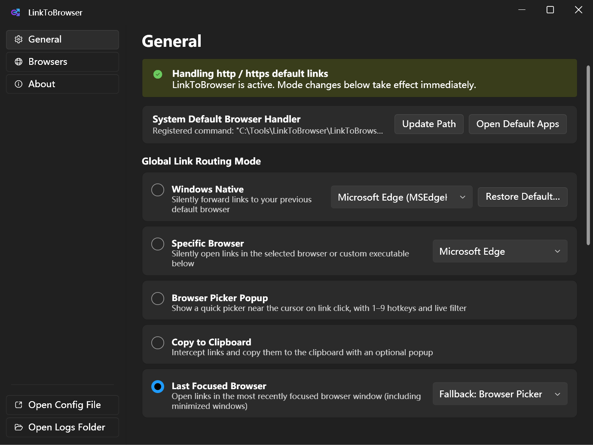
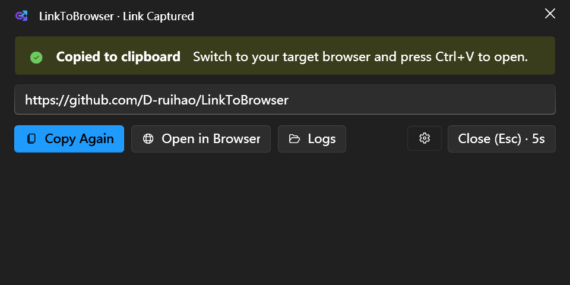

<div align="center">
  
  <h1>LinkToBrowser</h1>
  <p>
    <strong>A lightweight Windows 11 URL router, browser picker, and clipboard link handler</strong><br/>
    <sub>Route external links from any app directly to your last focused browser, specific Chrome profile, clipboard, or active isolated browser windows</sub>
  </p>
  <p>
    <a href="README.md">简体中文</a> | <strong>English</strong>
    &nbsp;·&nbsp;
    <a href="https://github.com/D-ruihao/LinkToBrowser/releases">Download Releases</a>
  </p>
</div>

---

## Why LinkToBrowser?

When you work across multiple browsers, Chrome/Edge profiles, or isolated browser environments on Windows 11, clicking a link inside chat apps or editors normally opens a single static system browser.

`LinkToBrowser` acts as your per-user `HTTP` / `HTTPS` handler and routes each link click according to your workflow:

## Features

- **Five Link Routing Modes**
  1. **Last Focused Browser**: Follows Windows window activation order (including minimized windows) and opens the URL in whichever browser window you focused most recently, with a configurable fallback when none are open.
  2. **Browser Picker Popup**: Shows a compact picker near the cursor on click with `1–9` hotkeys, live search filtering, `↑/↓` + `Enter` launch, and `Ctrl+C` copy.
  3. **Specific Browser**: Silently launches links in a selected installed browser, Chromium profile, active isolated browser window, or custom executable.
  4. **Copy to Clipboard**: Copies clicked URLs to the clipboard with an optional auto-closing confirmation popup (pauses on hover or input focus).
  5. **Windows Native**: Silently forwards URLs to your previously configured system default browser.
- **Isolated / Antidetect Browser Window Support (via `DevToolsActivePort` / CDP)**
  - Discovers running isolated Chromium browser windows exposing a local `DevToolsActivePort` and opens clicked links as new tabs directly inside the active window across **Last Focused Browser**, **Browser Picker Popup**, and **Specific Browser** modes.
  - **Compatibility note**: This integration has currently been **tested and verified only on BitBrowser**. Other Chromium-based antidetect or isolated browsers that expose a standard `DevToolsActivePort` may work through the same mechanism depending on their configuration; if direct tab creation fails or is unavailable, LinkToBrowser safely falls back to copying the URL to your clipboard.
- **Portable & Per-User (`HKCU`) Registration**
  - Built on Windows 11's inbox `.NET Framework 4.8` runtime—just extract and run with no installer or extra dependencies.
  - Stores `config.json` and `logs\` next to the executable (falling back to `%LOCALAPPDATA%\LinkToBrowser` in read-only directories).
  - Registers solely under `HKCU` without requiring administrator privileges and is cleanly removable anytime.
- **Bilingual UI & Adaptive Theme**
  - Instant switching between **English**, **简体中文**, and **Follow System**, with Light, Dark, and Windows 11 Mica themes.
  - Supports a holdable modifier key (`Alt` or `Shift`) to temporarily summon the picker from any silent mode.

---

## Screenshots

| Settings Window (Last Focused Mode) | Browser Picker Popup |
| :---: | :---: |
|  |  |

| Clipboard Confirmation Popup |
| :---: |
|  |

---

## Quick Start

1. Download `LinkToBrowser-portable.zip` from [Releases](https://github.com/D-ruihao/LinkToBrowser/releases) and extract it to a permanent folder (e.g. `C:\Tools\LinkToBrowser\`).
2. Run `LinkToBrowser.exe` to open Settings.
3. Click **Register Now** (or pass `--register`), then click **Open Default Apps** and set `LinkToBrowser` as your default for `HTTP` / `HTTPS`.

### CLI Arguments

- *(no args)* or `--settings`: Open Settings
- `--register`: Register `LinkToBrowser.exe` under `HKCU` and snapshot your previous default `ProgId`
- `--unregister`: Remove `LinkToBrowser` entries from `HKCU`
- `--no-ui <url>`: Silently copy URL to clipboard (`0` on success, `2` on failure)

### Restore & Uninstall

Click **Restore Default…** in Settings (or run `LinkToBrowser.exe --unregister` and open Windows Default Apps), switch `http`/`https` back to your browser, clean up HKCU entries, and remove the folder.

---

## Build from Source

Requires Windows 11 and .NET SDK (.NET 7+ SDK).

```powershell
powershell -ExecutionPolicy Bypass -File .\scripts\build.ps1
```

Outputs `dist\LinkToBrowser\` and `dist\LinkToBrowser-portable.zip`.

## License

[MIT](LICENSE)
