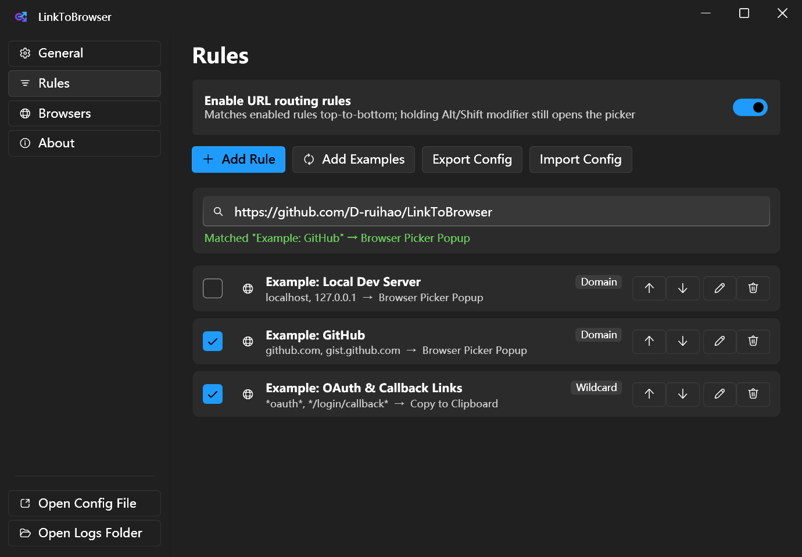

<div align="center">
  
  <h1>LinkToBrowser</h1>
  <p>
    <strong>A lightweight Windows 11 URL router, browser picker, and clipboard link handler</strong><br/>
    <sub>Route external HTTP / HTTPS links by rule to a specific browser, last focused window, isolated browser, or clipboard</sub>
  </p>
  <p>
    <a href="README.md">简体中文</a> | <strong>English</strong>
    &nbsp;·&nbsp;
    <a href="https://github.com/D-ruihao/LinkToBrowser/releases">Download Releases</a>
  </p>
</div>

---

## Features

Windows 11 only lets you bind one fixed default browser for `HTTP`/`HTTPS`, and cannot send external link clicks straight into active isolated / antidetect browser windows. Once set as your per-user `HTTP` / `HTTPS` handler, `LinkToBrowser` routes every clicked link flexibly:

- **URL Routing Rules**: Match by **Domain** (dot-boundary safe, supports `*.` and ports), **URL Prefix**, or **Wildcard** (`*` / `?`) top-to-bottom. Route hits to a specific browser, Chromium profile, custom `.exe`, active isolated window, clipboard, picker, last focused browser, or Windows native default. Includes disabled example templates, a live URL match tester, and `Alt`/`Shift` modifier override to summon the picker.
- **Five Global Modes** *(when no rule matches)*:
  1. **Last Focused Browser**: Opens links in the most recently focused browser window (including minimized windows), with configurable fallback.
  2. **Browser Picker Popup**: Appears near the cursor with `1–9` hotkeys, live filtering, `↑/↓` + `Enter` launch, and `Ctrl+C` copy.
  3. **Specific Browser**: Silently opens links in a chosen browser, Chromium profile, active isolated window, or custom executable.
  4. **Copy to Clipboard**: Captures and copies links with an optional auto-closing confirmation popup.
  5. **Windows Native**: Silently forwards links to your previously recorded default browser.
- **Isolated / Antidetect Browser Support (`DevToolsActivePort` / CDP)**: Discovers running Chromium isolated windows exposing a local `DevToolsActivePort` and opens new tabs directly inside them across Rules, Last Focused, Picker, and Specific Browser modes. *Compatibility note: verified on BitBrowser; other Chromium isolated browsers exposing a standard `DevToolsActivePort` depend on their own configuration, and unavailable targets safely fall back to clipboard copy.*
- **Config Backup & Automation CLI**: Export/import full configs or rules + custom browsers as JSON (auto-backs up `config.bak.json` before import, supports merge or replace); headless CLI with UTF-8 `--json` output for scripting and automation.
- **Portable & Per-User (`HKCU`)**: Runs on Windows 11's inbox `.NET Framework 4.8` with no admin rights required; stores `config.json` and `logs\` next to the executable, with instant English/Chinese switching and Light/Dark Mica themes.

---

## Screenshots

| Settings Window (General / Modes) | Routing Rules & Live Tester |
| :---: | :---: |
|  |  |

| Browser Picker Popup | Clipboard Confirmation Popup |
| :---: | :---: |
|  |  |

---

## Quick Start

1. Download `LinkToBrowser-portable.zip` from [Releases](https://github.com/D-ruihao/LinkToBrowser/releases) and extract to a permanent folder (e.g. `C:\Tools\LinkToBrowser\`).
2. Run `LinkToBrowser.exe` and click **Register Now** (or run `--register`).
3. Click **Open Default Apps** and set `LinkToBrowser` as the default for `HTTP` and `HTTPS`.

**Restore & Uninstall**: Click **Restore Default…** in Settings (or run `--unregister`), switch `HTTP`/`HTTPS` back to your browser in Windows Default Apps, clean up `HKCU` entries, and delete the folder.

---

## CLI Interface

```powershell
# Inspect commands, status, and browsers
LinkToBrowser.exe --help --json
LinkToBrowser.exe --status --include-running --json
LinkToBrowser.exe --list-browsers --include-running --json

# Switch mode / manage rules / dry-run routing
LinkToBrowser.exe --set-mode recent --fallback clipboard --json
LinkToBrowser.exe --rules add --name "GitHub" --kind domain --pattern "github.com, *.github.com" --action open --target "Edge" --json
LinkToBrowser.exe --test-url "https://gist.github.com/D-ruihao" --json

# Open in specific target / export & import backup (supports --config-dir)
LinkToBrowser.exe --browser "Edge" "https://example.com" --json
LinkToBrowser.exe --export ".\backup.json" --rules-only --json
LinkToBrowser.exe --import ".\backup.json" --json
```

Standard flags: *(none)* or `--settings` (open Settings), `--register` / `--unregister` (`HKCU` setup/cleanup), `--no-ui <url>` (silent clipboard copy, exit `0` on success).  
*Note: Because this is a Windows GUI (`WinExe`) binary to avoid console flashes on link clicks, pipe output in PowerShell (e.g. `| ConvertFrom-Json` or `| Out-String`); subprocesses with redirected stdout receive UTF-8 JSON directly.*

---

## Build from Source

Requires Windows 11 and .NET 7+ SDK:

```powershell
powershell -ExecutionPolicy Bypass -File .\scripts\build.ps1
```

Outputs `dist\LinkToBrowser\` and `dist\LinkToBrowser-portable.zip`.

## License

[MIT](LICENSE)
