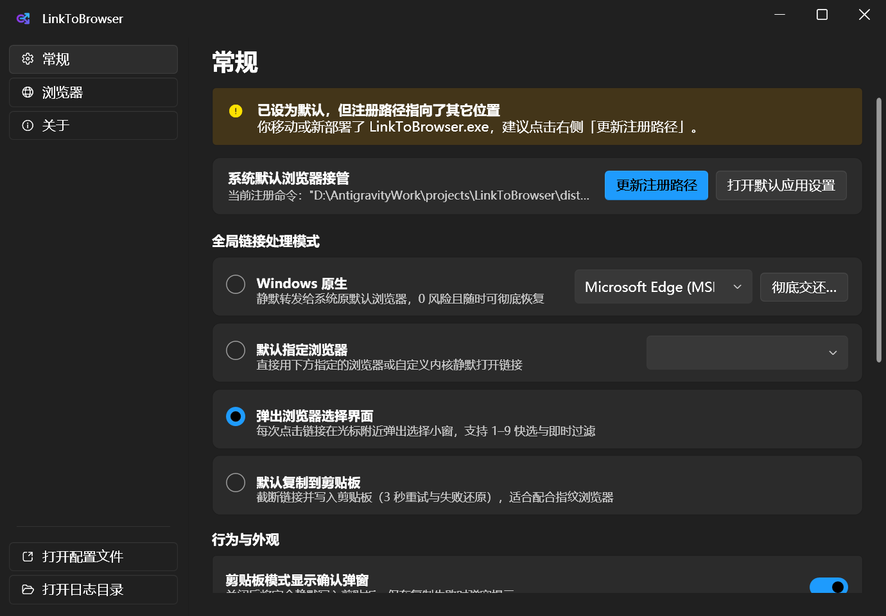

<div align="center">
  
  <h1>LinkToBrowser</h1>
  <p>
    <strong>A lightweight, portable, zero-risk Windows 11 URL router, browser picker, and clipboard link handler</strong><br/>
    <sub>Built for multi-browser workflows, Chromium multi-profiles, and antidetect/fingerprint browsers</sub>
  </p>
  <p>
    <a href="README.md">简体中文</a> | <strong>English</strong>
    &nbsp;·&nbsp;
    <a href="https://github.com/D-ruihao/LinkToBrowser/releases">Download Releases</a>
  </p>
</div>

---

## Key Features

- **100% Portable & Zero Runtime Dependencies**
  - Built on Windows 11's inbox `.NET Framework 4.8` and `WPF-UI`. Extract `LinkToBrowser-portable.zip` and run immediately—no extra runtimes or installers required.
  - `config.json` and logs (`logs\links.log`, `logs\args.log`) live right inside the app folder (falling back to `%LOCALAPPDATA%\LinkToBrowser` only when placed in read-only system paths). Exits cleanly when closed with zero background resident processes.
- **Four Global Link Routing Modes**
  1. **Windows Native**: Silently forwards URLs to your original default browser recorded prior to activation—zero risk and reversible anytime.
  2. **Specific Browser**: Silently launches links in any selected installed browser or custom `.exe` + argument template.
  3. **Browser Picker Popup**: Opens a compact picker near your cursor on link click, supporting `1–9` digit hotkeys, instant search filtering, `↑/↓` + `Enter` launch, and `Ctrl+C` copy.
  4. **Copy to Clipboard**: Intercepts URLs and writes them to the clipboard (with 3-second busy retry and fallback restoration), paired with an optional auto-closing confirmation popup (pauses on hover/focus) and one-click "Open in Browser".
- **Multi-Profile & Antidetect Browser Friendly**
  - Automatically discovers Windows-registered browsers (filtering out fake media-player associations) and Chromium user profiles, plus supports custom portable/fingerprint browser executables with `{url}` launch templates.
  - Hold a configurable modifier key (`Alt` or `Shift`) while clicking a link to temporarily summon the picker from any silent mode.
- **Safe `HKCU`-Only Registration**
  - Requires no Administrator privileges and never writes protected Windows `UserChoice` hashes. One-click restore opens Windows Default Apps and cleanly removes all `HKCU` entries.
- **Bilingual UI & Adaptive Theme**: Instant runtime switching between **English**, **简体中文**, and **Follow System**, with Windows 11 Light/Dark/Mica support.

---

## Screenshots

| Settings Window (General / Routing Modes) | Browser Picker Popup (Light / English) |
| :---: | :---: |
|  |  |

| Clipboard Confirmation Popup (Dark Mode / Countdown) |
| :---: |
|  |

---

## Quick Start

1. Download the latest `LinkToBrowser-portable.zip` from [Releases](https://github.com/D-ruihao/LinkToBrowser/releases) and extract it to a permanent folder (e.g., `C:\Tools\LinkToBrowser\`).
2. Run `LinkToBrowser.exe` to open Settings (you can switch **Language** to **English** under Behavior & Appearance).
3. Click **Register Now** (or run `LinkToBrowser.exe --register`—no admin needed), then click **Open Default Apps** and set `LinkToBrowser` as the default handler for `HTTP` / `HTTPS`.

### CLI Flags

- *(no args)* or `--settings`: Single-instance open Settings window
- `--register`: Register current `LinkToBrowser.exe` in `HKCU` and snapshot your previous default browser `ProgId`
- `--unregister`: Remove `LinkToBrowser` entries from `HKCU`
- `--no-ui <url>`: Copy URL silently to clipboard (`0` on success, `2` on failure)
- `-Embedding` / `--version`: Exit silently without modifying the clipboard

### Clean Restore & Uninstall

Click **Restore Default…** in Settings (or run `LinkToBrowser.exe --unregister` and open Windows Default Apps), switch `http`/`https` back to your browser, confirm HKCU cleanup, and delete the folder.

---

## Build from Source

Requires Windows 11 and .NET SDK (.NET 7+ SDK).

```powershell
powershell -ExecutionPolicy Bypass -File .\scripts\build.ps1
```

This runs all unit tests (`dotnet test`), builds the Release portable folder `dist\LinkToBrowser\`, and packages `dist\LinkToBrowser-portable.zip`.

## License

[MIT](LICENSE)
