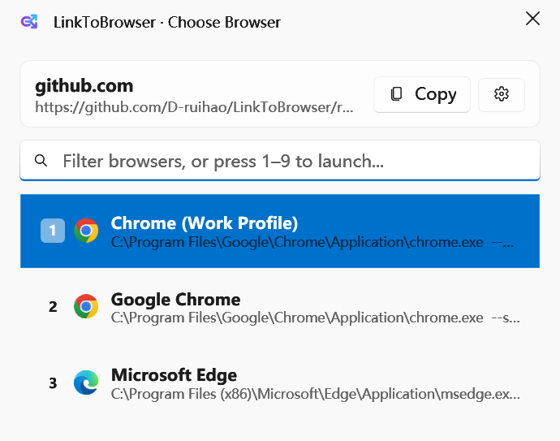

<div align="center">
  
  <h1>LinkToBrowser</h1>
  <p>
    <strong>A lightweight Windows 11 URL router, browser picker, and clipboard link handler</strong><br/>
    <sub>Switch effortlessly between browsers, user profiles, and clipboard workflows when opening links</sub>
  </p>
  <p>
    <a href="README.md">简体中文</a> | <strong>English</strong>
    &nbsp;·&nbsp;
    <a href="https://github.com/D-ruihao/LinkToBrowser/releases">Download Releases</a>
  </p>
</div>

---

## Features

- **Portable & Ready to Use**
  - Runs on Windows 11's inbox `.NET Framework 4.8` runtime—just extract and run with no installer or extra dependencies.
  - Stores `config.json` and `logs\` next to the executable (falling back to `%LOCALAPPDATA%\LinkToBrowser` in read-only directories).
- **Four Link Routing Modes**
  1. **Windows Native**: Silently forwards links to your previously configured default browser.
  2. **Specific Browser**: Silently opens links using a selected browser or custom executable and arguments.
  3. **Browser Picker Popup**: Displays a compact picker near the cursor with `1–9` quick-launch keys, live search filtering, `↑/↓` + `Enter`, and `Ctrl+C` copy.
  4. **Copy to Clipboard**: Copies links directly to the clipboard with an optional auto-closing confirmation popup (pauses on hover or input focus).
- **Multi-Profile & Custom Launchers**
  - Automatically discovers installed browsers and Chromium user profiles (Chrome / Edge), plus lets you add custom `.exe` paths with `{url}` templates.
  - Configure a modifier key (`Alt` or `Shift`) to temporarily bring up the picker on click while in any silent mode.
- **Per-User (`HKCU`) Registration**
  - Requires no administrator privileges and leaves system-protected defaults untouched until you select it in Windows Default Apps. Cleanly removable anytime.
- **Bilingual UI & Adaptive Theme**
  - Instant switching between **English**, **简体中文**, and **Follow System**, with Light, Dark, and Windows 11 Mica theme support.

---

## Screenshots

| Settings Window | Browser Picker Popup |
| :---: | :---: |
|  |  |

| Clipboard Confirmation Popup |
| :---: |
|  |

---

## Quick Start

1. Download `LinkToBrowser-portable.zip` from [Releases](https://github.com/D-ruihao/LinkToBrowser/releases) and extract it to a permanent folder (e.g. `C:\Tools\LinkToBrowser\`).
2. Run `LinkToBrowser.exe` to open Settings.
3. Click **Register Now** (or pass `--register`), then click **Open Default Apps** and set `LinkToBrowser` as your default for `HTTP` / `HTTPS`.

### CLI Arguments

- *(no args)* or `--settings`: Open Settings
- `--register`: Register `LinkToBrowser.exe` under `HKCU` and snapshot your previous default `ProgId`
- `--unregister`: Remove `LinkToBrowser` entries from `HKCU`
- `--no-ui <url>`: Silently copy URL to clipboard (`0` on success, `2` on failure)

### Restore & Uninstall

Click **Restore Default…** in Settings (or run `LinkToBrowser.exe --unregister` and open Windows Default Apps), select your previous browser, clean up HKCU entries, and remove the folder.

---

## Build from Source

Requires Windows 11 and .NET SDK (.NET 7+ SDK).

```powershell
powershell -ExecutionPolicy Bypass -File .\scripts\build.ps1
```

Outputs `dist\LinkToBrowser\` and `dist\LinkToBrowser-portable.zip`.

## License

[MIT](LICENSE)
