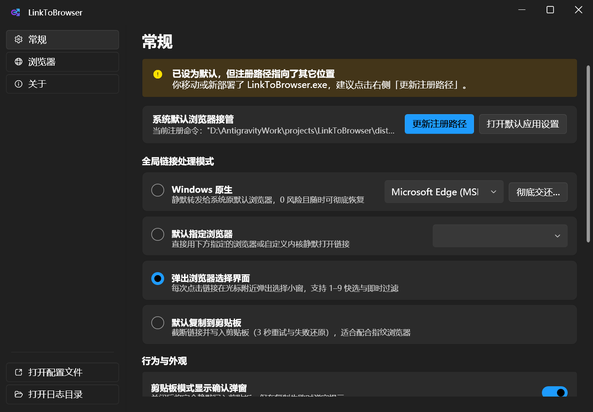
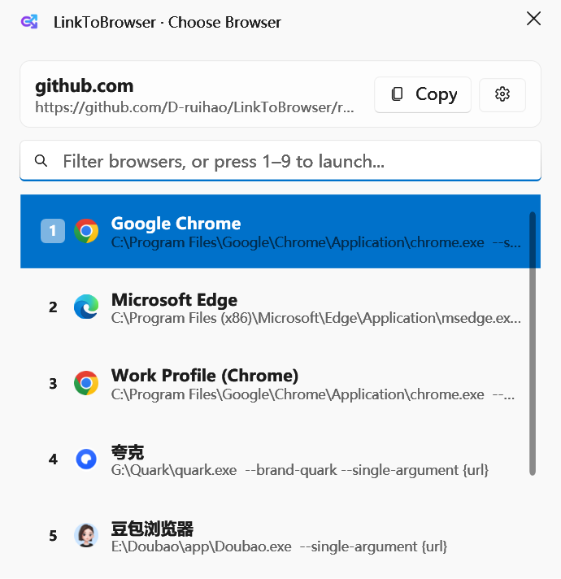
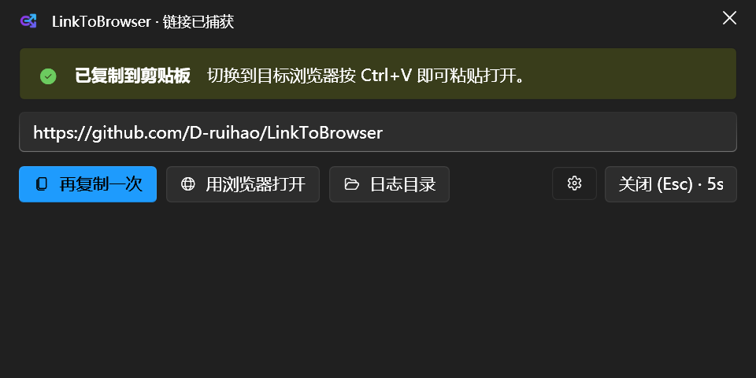

<div align="center">
  
  <h1>LinkToBrowser</h1>
  <p>
    <strong>Windows 11 轻量级、全便携、0 风险的默认浏览器链接路由与剪贴板拦截工具</strong><br/>
    <sub>专为多浏览器用户、Chromium 多账号配置文件与指纹浏览器（BitBrowser / AdsPower 等）工作流打造</sub>
  </p>
  <p>
    <strong>简体中文</strong> | <a href="README.en.md">English</a>
    &nbsp;·&nbsp;
    <a href="https://github.com/D-ruihao/LinkToBrowser/releases">下载 Release</a>
  </p>
</div>

---

## 核心特性

- **全便携免安装（配置与日志随文件夹带走）**
  - 基于 Windows 11 系统自带 `.NET Framework 4.8` 与 `WPF-UI`，下载解压 `LinkToBrowser-portable.zip` 即可运行，无需安装额外运行时。
  - 配置文件 `config.json` 与日志 `logs\links.log`、`logs\args.log` 全部保存在程序同级目录（仅在置于无写入权限的系统目录时回退到 `%LOCALAPPDATA%\LinkToBrowser`）；关闭设置窗口即彻底退出，零后台常驻。
- **四种链接处理模式，随时一键切换**
  1. **Windows 原生**：静默转交给启用前记录的系统原默认浏览器，零侵入且随时可无痕恢复。
  2. **默认指定浏览器**：静默使用你在列表中选定的浏览器或任意自定义 `.exe` + 参数打开链接。
  3. **弹出浏览器选择界面**：在光标附近弹出紧凑选择器，支持 `1–9` 数字键快选、实时搜索过滤、`↑/↓` + `Enter` 启动、`Ctrl+C` 复制。
  4. **默认复制到剪贴板**：3 秒重试防占用写入剪贴板（失败自动还原剪贴板原内容），可配确认弹窗与自动关闭倒计时，支持悬停/聚焦自动暂停，并可一键临时转为「用浏览器打开」。
- **多浏览器与指纹浏览器友好**
  - 自动发现系统注册表浏览器（智能过滤媒体文件伪关联）及 Chromium 多用户 Profile，同时支持添加任意便携版/指纹浏览器内核与 `{url}` 启动参数模板。
  - 支持全局修饰键（按住 `Alt` 或 `Shift` 点击链接）在静默模式下临时唤出选择弹窗。
- **纯 `HKCU` 用户级注册，0 风险彻底可逆**
  - 不需要管理员权限，绝不硬写受 Windows 保护的 `UserChoice` 哈希；支持一键还原打开系统默认应用设置并彻底清理注册表残留。
- **双语界面与深浅主题**：内置 **简体中文 / English / 跟随系统** 实时免重启切换，自动适配 Windows 11 深色/浅色与 Mica 质感。

---

## 界面预览

| 设置主面板（常规 / 模式切换） | 浏览器选择弹窗（英文 / 浅色模式） |
| :---: | :---: |
|  |  |

| 剪贴板捕获确认浮窗（深色模式 / 自动关闭倒计时） |
| :---: |
|  |

---

## 快速开始

1. 前往 [Releases](https://github.com/D-ruihao/LinkToBrowser/releases) 下载最新便携压缩包 `LinkToBrowser-portable.zip`，解压到固定目录（例如 `C:\Tools\LinkToBrowser\`）。
2. 双击运行 `LinkToBrowser.exe` 打开设置窗口（可在设置底部切换界面语言为 **简体中文** 或 **English**）。
3. 点击 **「立即注册」**（或在终端执行 `LinkToBrowser.exe --register`，无需管理员权限），再点击 **「打开默认应用设置」**，在 Windows 设置中搜索 `LinkToBrowser` 并设为 `HTTP` / `HTTPS` 默认应用即可。

### 常用命令行参数

- 无参数或 `--settings`：单实例打开设置窗口
- `--register`：将当前路径下的 `LinkToBrowser.exe` 注册到 `HKCU` 并记录原默认浏览器 `ProgId`
- `--unregister`：清理 `HKCU` 下的 `LinkToBrowser` 注册项
- `--no-ui <url>`：强制静默复制链接到剪贴板（成功返回码 `0`，失败返回码 `2`）
- `-Embedding` / `--version` 等：静默退出且不改动剪贴板

### 彻底交还与卸载

在设置页点击 **「彻底交还…」**（或运行 `LinkToBrowser.exe --unregister` 后打开 Windows 默认应用设置），将 `http`/`https` 改回原浏览器并确认清理 `HKCU` 注册项，随后直接删除所在文件夹即可，零残留。

---

## 本地构建与测试

依赖环境：Windows 11 + .NET SDK（.NET 7+ SDK）。

```powershell
powershell -ExecutionPolicy Bypass -File .\scripts\build.ps1
```

脚本将自动运行全部单元测试（`dotnet test`），编译 Release 便携目录 `dist\LinkToBrowser\`，并打包输出 `dist\LinkToBrowser-portable.zip`。

## 开源协议

[MIT](LICENSE)
