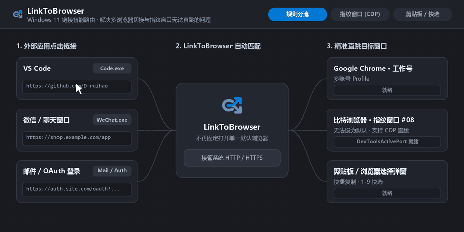
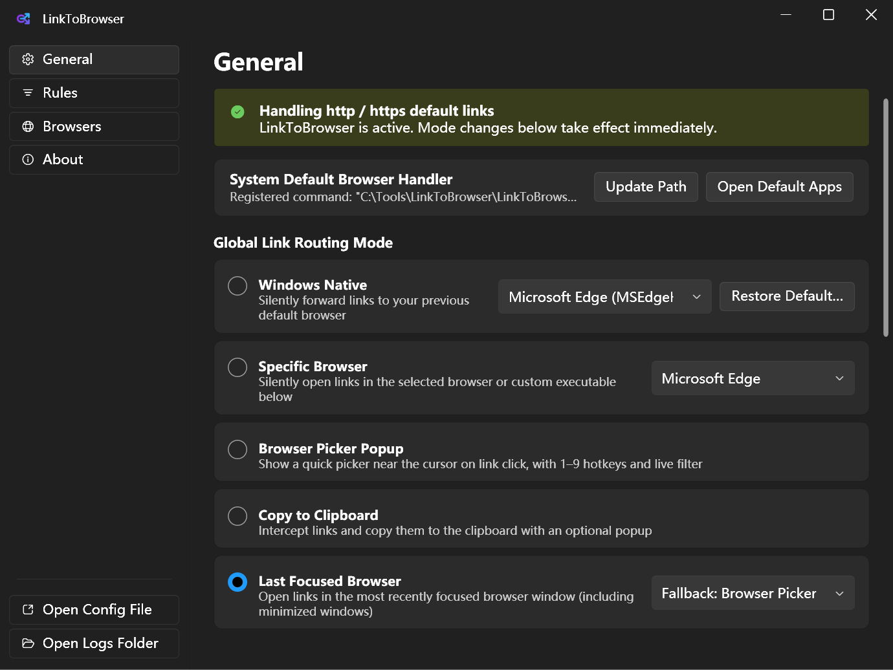
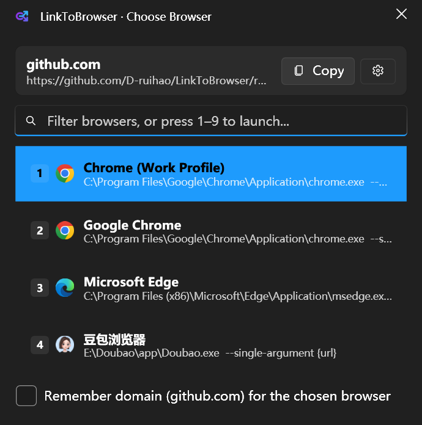

<div align="center">
  
  <h1>LinkToBrowser</h1>
  <p>
    <strong>Windows 11 链接智能分流路由、浏览器选择器与剪贴板工具</strong><br/>
    <sub>
      多浏览器窗口下链接无法快速跳到想要的浏览器？指纹浏览器窗口无法设为系统默认浏览器？<br/>
      设为默认后，点击任意外部链接即可按规则自动分流、弹窗快选，或直跳指纹浏览器窗口。
    </sub>
  </p>
  <p>
    <strong>简体中文</strong> | <a href="README.en.md">English</a>
    &nbsp;·&nbsp;
    <a href="https://github.com/D-ruihao/LinkToBrowser/releases">下载 Release</a>
  </p>
  
</div>

---

## 核心功能

- **按链接与来源应用分流**：支持 **域名**（含 `*.` 通配、端口与 IPv6）、**URL 前缀**、**通配符**（`*` / `?`）以及 **来源应用**（如 `WeChat.exe`、`QQ.exe`、`Code.exe`）匹配；支持规则筛选复制、实时测试与 `Alt`/`Shift` 临时弹窗，还可在选择弹窗中勾选「记住此域名」一键置顶建规。
- **五种全局模式**（未命中规则时生效）：
  1. **最近聚焦的浏览器**：按窗口活跃顺序自动跳到最近聚焦的浏览器（含已最小化窗口），支持无窗口回退策略。
  2. **浏览器选择弹窗**：光标附近弹出（兼容混合 DPI 多显示器），支持 `1–9` 快选、搜索、`Ctrl+C` 复制与一键记住域名。
  3. **默认指定浏览器**：静默使用指定浏览器、Chrome/Edge 多账号 Profile、活跃独立窗口或自定义 `.exe` 打开。
  4. **复制到剪贴板**：静默或带自动倒计时浮窗复制链接。
  5. **Windows 原生**：转发给接管前记录的原系统默认浏览器。
- **指纹 / 独立浏览器窗口直跳（CDP）**：自动发现开放本地 `DevToolsActivePort` 的隔离 Chromium 窗口，直接向目标窗口新建标签页。*目前在比特浏览器（BitBrowser）完成实机验证；不可用时自动安全复制到剪贴板。*
- **链接预处理、备份与 CLI**：可选自动解包知乎/掘金/QQ/Outlook 等中转链接（默认关闭，避开 OAuth）与自定义清理追踪参数；支持配置 JSON 导入导出（自动备份 `config.bak.json`）、`links.log` 结构化日志及 UTF-8 `--json` 命令行。
- **绿色便携与零管理员权限**：基于 Windows 11 自带 `.NET Framework 4.8`，用户级 `HKCU` 注册与卸载；配置与日志同目录保存，支持中英双语与深浅色 Mica 自适应。

---

## 界面预览

| 设置主面板（常规 / 模式） | 分流规则与测试预览 |
| :---: | :---: |
|  |  |

| 浏览器选择弹窗 | 剪贴板确认浮窗 |
| :---: | :---: |
|  |  |

---

## 快速开始

1. 从 [Releases](https://github.com/D-ruihao/LinkToBrowser/releases) 下载 `LinkToBrowser-portable.zip` 并解压到固定目录（如 `C:\Tools\LinkToBrowser\`）。
2. 运行 `LinkToBrowser.exe`，点击 **「立即注册」**（或执行 `--register`）。
3. 点击 **「打开默认应用设置」**，将 `LinkToBrowser` 设为 `HTTP` 和 `HTTPS` 默认应用即可。

**还原与卸载**：在设置中点击 **「还原默认…」**（或执行 `--unregister`），在系统默认应用改回原浏览器并清理 `HKCU` 注册项，随后删除目录即可。

---

## 命令行接口（CLI）

```powershell
# 查看命令、状态与浏览器列表
LinkToBrowser.exe --help --json
LinkToBrowser.exe --status --include-running --json
LinkToBrowser.exe --list-browsers --include-running --json

# 切换模式 / 管理规则 / 模拟路由测试
LinkToBrowser.exe --set-mode recent --fallback clipboard --json
LinkToBrowser.exe --rules add --name "GitHub" --kind domain --pattern "github.com, *.github.com" --source-app "Code.exe" --action open --target "Edge" --json
LinkToBrowser.exe --test-url "https://gist.github.com/D-ruihao" --source-app "Code.exe" --json

# 定向打开链接 / 备份与恢复（支持 --config-dir 指定隔离目录）
LinkToBrowser.exe --browser "Edge" "https://example.com" --json
LinkToBrowser.exe --export ".\backup.json" --rules-only --json
LinkToBrowser.exe --import ".\backup.json" --json
```

常规参数：无参数或 `--settings`（打开设置）、`--register` / `--unregister`（注册/清理）、`--no-ui <url>`（静默复制，成功返回 `0`）。  
*提示：因程序为无黑框 GUI 子系统，在 PowerShell 中查看或解析 stdout 请配合管道（如 `| ConvertFrom-Json` 或 `| Out-String`）；子进程重定向标准输出可直接读取 UTF-8 JSON。*

---

## 从源码构建

需要 Windows 11 与 .NET 7+ SDK：

```powershell
powershell -ExecutionPolicy Bypass -File .\scripts\build.ps1
```

产物输出至 `dist\LinkToBrowser\` 与 `dist\LinkToBrowser-portable.zip`。

## 友情链接

- [LINUX DO](https://linux.do/)：中文技术社区，聊开发、AI、开源软件和各种好用的工具。

## 开源协议

[MIT](LICENSE)
