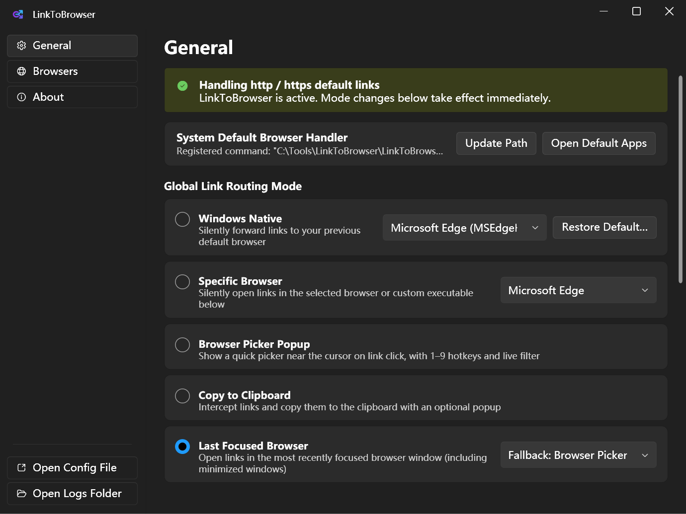

<div align="center">
  
  <h1>LinkToBrowser</h1>
  <p>
    <strong>Windows 11 默认浏览器链接路由、选择器与剪贴板拦截工具</strong><br/>
    <sub>解决从聊天软件或其它应用点击外部链接时，跳转到最近聚焦浏览器、指定浏览器或指纹浏览器窗口打开的问题</sub>
  </p>
  <p>
    <strong>简体中文</strong> | <a href="README.en.md">English</a>
    &nbsp;·&nbsp;
    <a href="https://github.com/D-ruihao/LinkToBrowser/releases">下载 Release</a>
  </p>
</div>

---

## 它解决什么问题？

在日常使用 Windows 11 时，从微信、QQ、编辑器或邮件客户端点击外部链接经常遇到两个痛点：

1. **多浏览器与多账号场景受限**：系统「默认应用」只能固定绑定一个浏览器，无法按需切换 Chrome、Edge、多用户 Profile 或不同打开方式。
2. **外部链接无法直接跳转到指纹浏览器窗口**：独立 / 指纹浏览器为了保持环境隔离，通常无法设为系统默认浏览器；从外部软件点击链接时，不仅不能自动打开到你正在使用的指纹浏览器窗口中，往往只能反复手动复制粘贴网址。

`LinkToBrowser` 注册为系统 `HTTP` / `HTTPS` 处理入口后，会按你的需求灵活路由每一个点击的链接：

## 核心功能

- **五种链接处理模式**
  1. **最近聚焦的浏览器（Last Focused Browser）**：按 Windows 窗口活跃顺序自动识别你最近一次使用或鼠标点击聚焦的浏览器窗口（即使已最小化也会还原跳转），并支持配置无可用浏览器时的回退模式。
  2. **弹出浏览器选择界面（Browser Picker Popup）**：点击链接时在光标附近弹出选择窗口，支持 `1–9` 数字快选、即时输入过滤、`↑/↓` + `Enter` 打开以及 `Ctrl+C` 复制。
  3. **默认指定浏览器（Specific Browser）**：静默使用你在列表中选定的浏览器、多用户配置、运行中的独立窗口或自定义 `.exe` 打开。
  4. **默认复制到剪贴板（Copy to Clipboard）**：自动拦截链接写入剪贴板，支持可选确认弹窗与自动关闭倒计时（悬停或聚焦链接框自动暂停）。
  5. **Windows 原生（Windows Native）**：静默转交给启用前记录的系统原默认浏览器。
- **独立 / 指纹浏览器窗口跳转支持（基于 `DevToolsActivePort` / CDP）**
  - 当开启对应选项后，能够发现当前运行中并开放了 Chromium `DevToolsActivePort` 调试端口的独立环境窗口，在「最近聚焦的浏览器」、「弹出选择界面」以及「默认指定浏览器」中直接向目标窗口新建标签页打开外部链接。
  - **兼容性说明**：该功能目前**仅在比特浏览器（BitBrowser）上完成实机验证**；其它基于 Chromium 内核且开放标准 `DevToolsActivePort` 的隔离环境浏览器理论上遵循相同机制，实际兼容性取决于具体浏览器自身设置（当无法直接接入时将安全提示并自动复制链接到剪贴板）。
- **绿色便携、纯用户级（`HKCU`）配置**
  - 基于 Windows 11 自带 `.NET Framework 4.8` 运行，下载解压即可使用；配置 `config.json` 与日志 `logs\` 保存在程序同级目录（无写入权限时回退到 `%LOCALAPPDATA%\LinkToBrowser`）。
  - 无需管理员权限即可注册到当前用户 `HKCU`，随时可还原系统默认浏览器并清理注册项。
- **双语实时切换 & 主题自适应**
  - 设置页支持 **简体中文 / English / 跟随系统** 实时切换，支持深色、浅色与跟随 Windows 11 系统主题。
  - 支持全局修饰键（`Alt` 或 `Shift`）在非弹窗模式下按住临时唤出选择器。

---

## 界面预览

| 设置主面板（含最近聚焦模式） | 浏览器选择弹窗 |
| :---: | :---: |
|  |  |

| 剪贴板确认浮窗 |
| :---: |
|  |

---

## 快速开始

1. 前往 [Releases](https://github.com/D-ruihao/LinkToBrowser/releases) 下载 `LinkToBrowser-portable.zip` 并解压到固定目录（例如 `C:\Tools\LinkToBrowser\`）。
2. 运行 `LinkToBrowser.exe` 打开设置窗口（可在设置底部切换界面语言为 **简体中文** 或 **English**）。
3. 点击 **「立即注册」**（或使用 `--register`），再点击 **「打开默认应用设置」**，在 Windows 设置中将 `LinkToBrowser` 设为 `HTTP` / `HTTPS` 默认应用即可。

### 命令行参数

- 无参数或 `--settings`：打开设置窗口
- `--register`：注册当前位置的 `LinkToBrowser.exe` 到 `HKCU` 并记录原默认浏览器 `ProgId`
- `--unregister`：清理 `HKCU` 下的 `LinkToBrowser` 注册项
- `--no-ui <url>`：静默复制链接到剪贴板（成功返回 `0`，失败返回 `2`）

### 还原与卸载

在设置页点击 **「还原默认…」**（或运行 `LinkToBrowser.exe --unregister` 后打开 Windows 默认应用设置），改回原浏览器并清理 `HKCU` 注册项，随后删除程序目录即可。

---

## 从源码构建

需要 Windows 11 与 .NET SDK（.NET 7+ SDK）。

```powershell
powershell -ExecutionPolicy Bypass -File .\scripts\build.ps1
```

输出便携目录 `dist\LinkToBrowser\` 与压缩包 `dist\LinkToBrowser-portable.zip`。

## 开源协议

[MIT](LICENSE)
